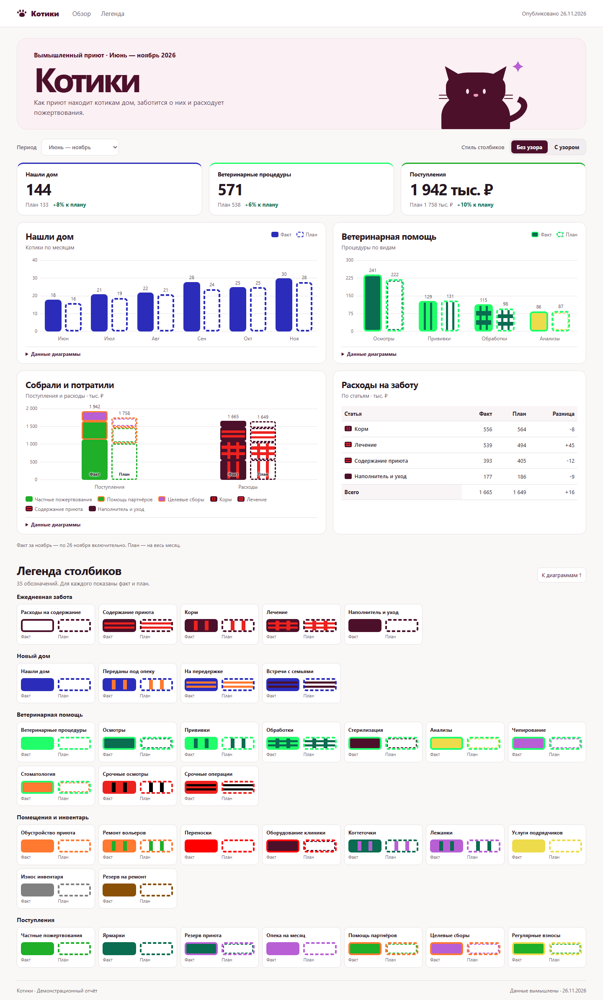

# Котики

Демонстрационный отчёт о работе вымышленного приюта. Дата публикации 26.11.2026.

Откройте `index.html` в браузере. Отчёт работает локально. Для запуска нужны файлы `index.html`, `report.css`, `palette.js` и `report.js` из этой папки.

- Переключите период, чтобы сравнить результаты за лето, осень и весь период.
- Используйте «Без узора» и «С узором», чтобы сравнить оформление одних и тех же диаграмм.
- Откройте «Легенду» в верхней навигации, чтобы просмотреть 35 пар «Факт» и «План» в каждой из двух версий оформления.
- Раскройте «Данные диаграммы», чтобы сверить значения в таблице.

Данные вымышлены. Операции за ноябрь показаны по 26.11 включительно, план за ноябрь — на месяц. Ветка содержит самостоятельное демо. Node BI для просмотра не требуется.

