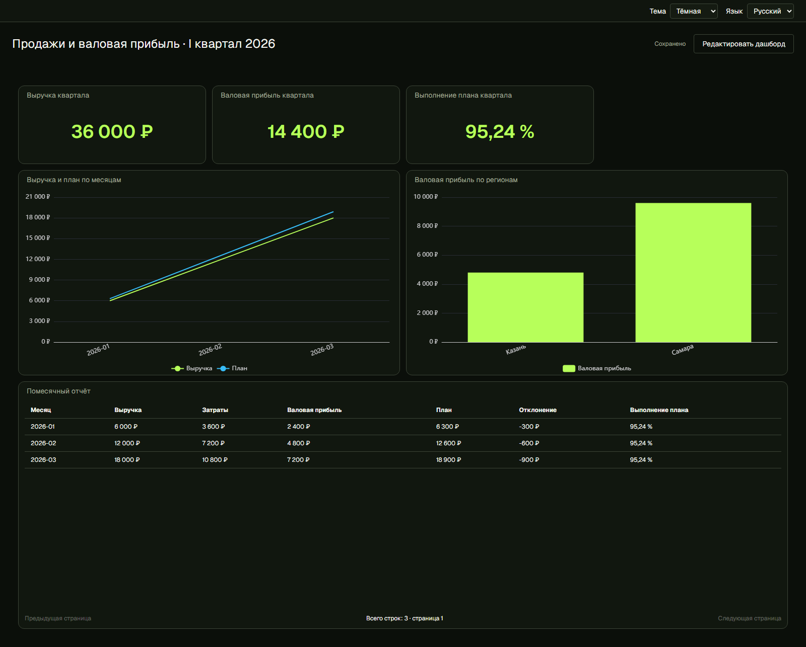

# Учебный дашборд «Продажи и валовая прибыль»

Сценарий: экономист торговой компании «Вектор» готовит отчёт за январь–март
2026 года. Нужно сравнить выручку с планом, увидеть валовую прибыль и вклад
двух регионов. Все компании, товары и операции вымышлены. Суммы — рубли без НДС.
Валовая прибыль здесь **не равна чистой прибыли**: расходы офиса, налоги,
возвраты и скидки в примере отсутствуют. Себестоимость единицы постоянна весь квартал.

## 1. Подготовить книги

Готовые файлы находятся в `fixtures/excel`:

| Файл | Лист | Содержание |
|---|---|---|
| [business-sales.xlsx](../fixtures/excel/business-sales.xlsx) | Продажи | 12 строк: Месяц, Регион, Товар, Количество, Цена |
| [business-costs.xlsx](../fixtures/excel/business-costs.xlsx) | Себестоимость | 2 строки: Товар, Себестоимость единицы |
| [business-plan.xlsx](../fixtures/excel/business-plan.xlsx) | План | 3 строки: Месяц, План |

Заголовки в первой строке, одна строка заголовка. Месяц — текст `2026-01`,
а не дата: фильтр календарного периода в этом примере не подключаем.
У товара А цена 100 и себестоимость 60, у Б — 200 и 120.
В январе Казань продаёт 10 А и 5 Б; Самара — 20 А и 10 Б.
В феврале количества вдвое больше январских, в марте — втрое.
План по месяцам: 6 300, 12 600 и 18 900.

Разработчик может воспроизвести файлы командой
`backend/.venv/Scripts/python.exe fixtures/build_business_demo.py`.
Экономисту запускать скрипт не нужно.

## 2. Загрузить данные и соединить таблицы

1. Создайте проект **«Вектор — продажи и валовая прибыль»**.
2. Загрузите три книги в источники проекта.
3. Откройте расчёт и создайте новый граф полевых нодов.
4. В панели книг раскройте каждую книгу и добавьте её лист на холст.
5. Выберите «Продажи» → **«Объединить с…»** → таблица «Себестоимость».
6. Ключи слева и справа — **Товар**, тип — **левое объединение**,
   ожидаемая связь — **многие к одному**. Добавьте шаг.
7. Запросите просмотр. Должны остаться 12 строк, без несовпавших товаров.
   Дубликат товара в справочнике — ошибка справочника, не повод удалять строки продаж.

## 3. Рассчитать выручку и прибыль

Последовательно добавьте три вычисляемых поля; каждый новый шаг использует
выход предыдущего. Можно использовать «Добавить вычисляемое поле» либо
«Вычисляемый столбец» в каталоге операций.

| Новое поле | Расчёт |
|---|---|
| Выручка | Количество × Цена |
| Затраты | Количество × Себестоимость единицы |
| Валовая прибыль | Выручка − Затраты |

Поля выбирайте по именам. В режиме формулы вставляйте их через список полей:
названия в этой инструкции — обозначения полей, а не текст для ручного ввода ID.
Пропуски не заменяем нулём: отсутствующая себестоимость требует исправить справочник.

## 4. Подготовить три результата

**Месяцы.** От выхода «Валовая прибыль» добавьте «Группировка» (Group By).
Ключ — Месяц. Три агрегата SUM: Выручка, Затраты, Валовая прибыль;
названия выходных полей оставьте такими же.
Теперь объедините эту таблицу с «План»: левое объединение по Месяцу,
связь многие к одному. План присоединяется **после группировки**, иначе
он повторится в каждой продаже и его сумма окажется завышенной.
Добавьте:

- Отклонение = Выручка − План.
- Выполнение плана = `safe_divide(Выручка, План, 0)`.

Вторая формула — отношение, не число процентов. Нулевой план даёт 0
по явно выбранной учебной политике; в реальном отчёте её нужно согласовать.
Опубликуйте выход под именем **«Продажи по месяцам»**.

**Итоги.** От последнего месячного шага добавьте группировку без ключей.
Сложите Выручку, Затраты, Валовую прибыль и План. Добавьте поле
Выполнение плана = `safe_divide(Выручка, План, 0)`.
Не складывайте и не усредняйте месячные проценты.
Опубликуйте **«Итоги квартала»**: должна получиться одна строка.

**Регионы.** Вернитесь к детальной таблице после расчёта Валовой прибыли.
Создайте отдельную ветку группировки по Региону с суммами Выручки,
Затрат и Валовой прибыли. Опубликуйте **«Продажи по регионам»**.
Публикации не копируют книги: несколько графиков используют общие расчёты.

## 5. Создать визуализации и дашборд

На карточке опубликованного результата выберите «Создать визуализацию».
Поля и оформление принадлежат визуализации; агрегации уже сделаны в графе.

| Название | Результат | Тип и поля |
|---|---|---|
| Выручка квартала | Итоги квартала | KPI, Выручка, деньги, 0 знаков |
| Валовая прибыль квартала | Итоги квартала | KPI, Валовая прибыль, деньги, 0 знаков |
| Выполнение плана квартала | Итоги квартала | KPI, Выполнение плана, проценты, 2 знака |
| Выручка и план по месяцам | Продажи по месяцам | Линии: категория Месяц, значение Выручка, вторая серия План; деньги |
| Валовая прибыль по регионам | Продажи по регионам | Столбцы: Регион → Валовая прибыль; деньги |
| Помесячный отчёт | Продажи по месяцам | Таблица |

Для денежного формата укажите валюту **RUB**. В таблице задайте общий формат
«Деньги / RUB / 0 знаков», а для столбца «Выполнение плана» отдельно выберите
«Проценты / 2 знака». Текстовый месяц остаётся текстом.
В выборе столбцов таблицы снимите флажок **Месяц__right**: это повтор ключа
из книги плана, оставленный Join. Для читателя достаточно первого «Месяц».

В разделе дашбордов создайте **«Продажи и валовая прибыль · I квартал 2026»**.
Через «Добавить график» разместите все шесть визуализаций. Используйте шаблон
раскладки «KPI и графики», затем при необходимости переместите и измените размеры карточек.
Если кнопка применения недоступна, текущее расположение уже соответствует
шаблону: закройте его предпросмотр кнопкой «Отмена».
Сохраните дашборд и откройте режим просмотра. Шестерёнка позволяет менять
отображение на этом же экране. Сохранение визуализации и раскладки — разные действия.

## 6. Проверить цифры

| Месяц | Выручка | Затраты | Валовая прибыль | План | Отклонение |
|---|---:|---:|---:|---:|---:|
| 2026-01 | 6 000 | 3 600 | 2 400 | 6 300 | −300 |
| 2026-02 | 12 000 | 7 200 | 4 800 | 12 600 | −600 |
| 2026-03 | 18 000 | 10 800 | 7 200 | 18 900 | −900 |
| Итого | **36 000** | **21 600** | **14 400** | **37 800** | **−1 800** |

Выполнение плана квартала — **95,24 %**. Валовая прибыль Казани — **4 800**,
Самары — **9 600**. Выручка регионов — **12 000** и **24 000** соответственно.
Проверка вручную: выручка Казани в январе = 10 × 100 + 5 × 200 = 2 000;
выручка Самары вдвое больше; квартальные количества = 1 + 2 + 3 январских.

Перезагрузите страницу: шесть виджетов и значения должны сохраниться.
Откройте расчёт и убедитесь, что формулы, источники и три результата доступны
для редактирования. Для регулярного обновления и фиксации неизменяемого выпуска
используйте [руководство цикла отчётов](REPORT_CYCLE.md).

Это учебный бизнес-пример, не предметная приёмка реального отчёта AlMaBi и
не измерение скорости работы экономиста.

## Проверенный результат

По инструкции собран редактируемый проект: 14 вычислительных нодов,
три публикации и шесть самостоятельных визуализаций. Браузерная проверка
сверяет месяцы, регионы и итоги с независимым эталоном и повторно открывает
сохранённый дашборд. Проект и загрузки подготавливаются через публичный API;
граф, публикации, визуализации и раскладка создаются через пользовательские формы.
Проверка воспроизводится командой из README, время автоматизации не является
оценкой времени экономиста.

